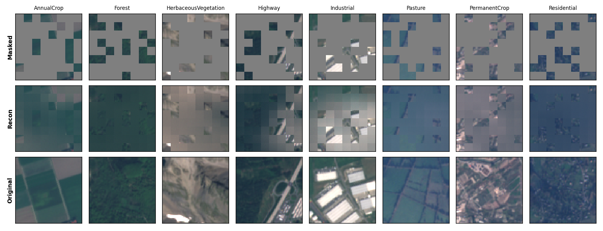
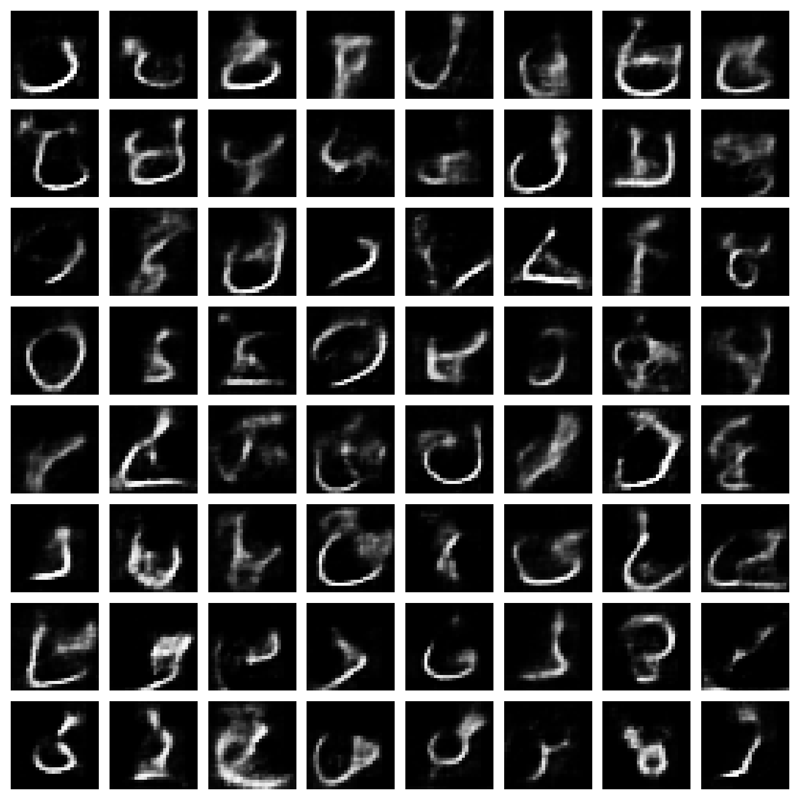
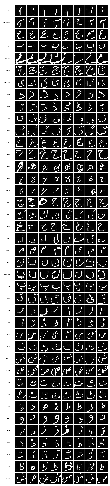
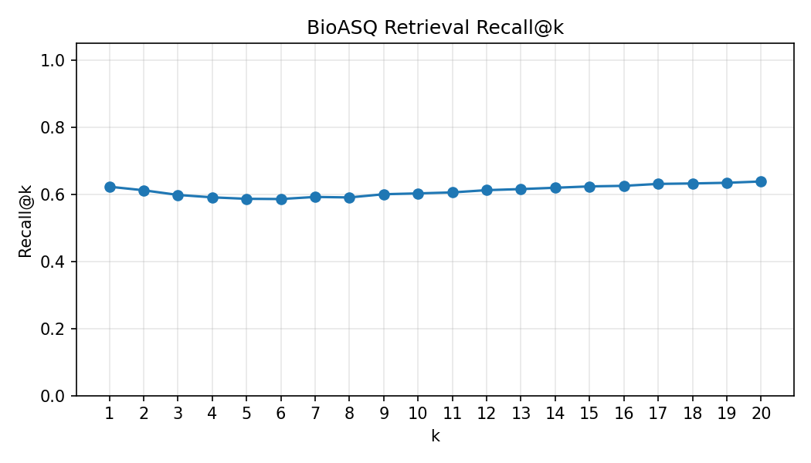

# Four Generative Models in One App: MAE, VAE, DDPM, and Biomedical RAG from Scratch

For our Generative AI project, we built four very different generative models from scratch in PyTorch and connected all of them in one Streamlit app:
1. A **Masked Autoencoder (MAE)** trained on EuroSAT satellite images without labels, then evaluated with a 160-image linear probe.
2. A **Variational Autoencoder (VAE)** trained on handwritten Urdu characters (UHaT) for reconstruction, sampling, and latent morphing.
3. A **Class-Conditional DDPM** trained on the same 40 Urdu character classes to write a requested letter from pure Gaussian noise.
4. A **Biomedical RAG pipeline** over 40,000+ PubMed abstracts (BioASQ) using MiniLM dense retrieval and Qwen2.5-1.5B-Instruct with inline citations.

We avoided high-level shortcuts like `timm`, `sentence-transformers`, `FAISS`, `LangChain`, `scikit-learn`, and `diffusers` schedulers, implementing the masking, ELBO, diffusion schedule, pooling, and retrieval metrics directly.

## Part A: Masked Autoencoder on Satellite Images

Each 64x64 EuroSAT tile is split into 64 patches of size 8x8 (192 pixel values each). At every training step, we randomly mask 75% of the patches (48 out of 64) independently per image. Only the 16 visible patches go through our 6-layer Transformer encoder (width 192, 3 heads). A smaller 2-layer decoder (width 128, 4 heads) fills the 48 missing slots with a learned mask token, adds decoder positional embeddings, and predicts pixel values. MSE loss is computed strictly on the 48 masked patches.

Why mask 75% when BERT only masks 15%? Language packs dense meaning into every token, whereas satellite images have strong local spatial redundancy. Masking only 15% lets a vision model copy neighbouring pixels instead of learning scene structure. With 75% hidden, our MAE had to reconstruct entire crop layouts, forest canopies, water bodies, and roads from sparse hints. After 100 epochs of unlabelled pretraining, we froze the encoder, mean-pooled all 64 patches, and trained a single linear layer on just 16 labelled images per class (160 total). Even with under 1% of the labels, test accuracy across 5,400 tiles far beats the 10% chance baseline, with most remaining confusions between visually similar vegetation classes (`AnnualCrop`, `PermanentCrop`, `Pasture`) and linear features (`Highway`, `River`).

## Part B: Variational Autoencoder on Urdu Handwriting

Next, we trained a convolutional VAE (latent dimension 16) on UHaT's 40 Urdu character classes (28x28 white strokes on black, no labels). Two strided convolutions predict $\mu$ and $\log \sigma^2$, the reparameterisation trick samples $z = \mu + \sigma \odot \epsilon$, and two transposed convolutions output pixel logits for a Bernoulli decoder. We optimised the exact negative ELBO in nats per image: BCE summed over all 784 pixels plus closed-form KL divergence against $\mathcal{N}(0, I)$.

Across 30 epochs (`results/vae_loss.png`), reconstruction BCE falls quickly while KL rises and stabilises. Without the KL term, the model would collapse into a deterministic autoencoder with empty holes in latent space, so random draws from $\mathcal{N}(0, I)$ would decode into garbled blobs instead of Urdu letters. With KL keeping the latent space smooth, linearly interpolating between $\mu$ of two test letters produces clean intermediate morphs (`results/vae_interpolation.png`).

## Part C: Writing Requested Urdu Characters with DDPM

VAE samples are fast to generate but noticeably blurry because a single-step pixel-independent Bernoulli decoder averages over uncertain stroke edges. To get sharper handwriting and explicit character control, we built a class-conditional DDPM on the same 40 Urdu characters (rescaled to $[-1, 1]$). Using only `diffusers.UNet2DModel` with random weights (`num_class_embeds=40`), we coded the $T=1000$ linear $\beta_t \in [10^{-4}, 0.02]$ schedule, forward noising (where $\bar{\alpha}_T \approx 4 \times 10^{-5}$ turns clean letters into noise), Algorithm 1 training (40 epochs), and Algorithm 2 reverse sampling.

The difference in sharpness compared to the VAE is immediate. Because diffusion keeps full 28x28 spatial resolution across 1,000 steps and refines coarse shape before fine edges, strokes and dots (*nuqtas*) come out crisp. In our blind 40-character recognisability test (`results/human_eval.csv`), both teammates labelled shuffled samples without seeing ground-truth names. Most mistakes happened inside *nuqta*-minimal families like *bay/pay/tay/say* and *jeem/chay/hay/khay*, where a single dot separates sibling letters.

## Part D: Biomedical RAG on BioASQ

For the fourth model, we built a dense RAG system over BioASQ's 40k+ PubMed abstracts and 707 expert test questions. Each abstract is split into chunks of at most 150 words with 30-word overlap and encoded with `sentence-transformers/all-MiniLM-L6-v2` loaded directly via `transformers.AutoModel`. We implemented attention-mask mean pooling and L2 normalisation ourselves so cosine search over all chunks is a single matrix multiplication, scoring each abstract by its best chunk.

On all test questions, dense retrieval beats random selection (around 0.025% Hit@10) by orders of magnitude. As expected mathematically, Recall@k stays below Hit@k for $k \ge 2$ because Hit@k rewards finding one relevant abstract while Recall@k requires finding all $\min(k, |R_q|)$ relevant abstracts. Passing the top 5 chunks numbered `[1]`-`[5]` into `Qwen/Qwen2.5-1.5B-Instruct` with greedy decoding (max 256 new tokens) produces concise, cited answers. Our error analysis showed that retrieval mainly fails when questions hinge on rare gene symbols or abbreviations; in those cases, Qwen either abstains ("I do not know") or risks citing off-topic snippets. Every answer in our app includes the notice: *"For educational use only. Not medical advice."*

## Results Summary

# Results Tables

## Table 1 - Data

| Item | Value |
|---|---|
| EuroSAT train / test images; labelled images used | 16,200 / 5,400; 160 |
| UHaT character classes; train / test images | 40 classes; TBD / TBD |
| BioASQ abstracts; chunks; test questions | 40,181 abstracts; TBD chunks; 707 test questions |
| Mean number of relevant abstracts per test question | TBD |

## Table 2 - Training

| Model | Parameters | Final training loss | Time / GPU |
|---|---:|---:|---:|
| MAE (encoder + decoder) | 3,173,504 | TBD | TBD |
| VAE | 220,385 | TBD | TBD |
| DDPM U-Net | 4,028,353 | TBD | TBD |

## Table 3 - Image results

| Metric | Value |
|---|---|
| MAE few-label classifier: test accuracy | TBD |
| VAE: test negative ELBO = reconstruction + KL (nats) | TBD |
| Diffusion: blind test, member 1 / member 2 correct (of 40) | TBD |
| Diffusion: images where both members agreed (of 40) | TBD |

## Table 4 - Retrieval

| Hit@1 | Hit@5 | Hit@10 | Recall@1 | Recall@5 | Recall@10 | MRR@10 |
|---:|---:|---:|---:|---:|---:|---:|
| TBD | TBD | TBD | TBD | TBD | TBD | TBD |

## Table 5 - Generation (100 questions)

| Metric | Value |
|---|---|
| ROUGE-L | TBD |
| Citation precision | TBD |
| "I don't know" rate | TBD |
| Human: supported, member 1 / member 2 (of 20) | TBD |
| Human: correct, member 1 / member 2 (of 20) | TBD |

## Putting All Four Models in One App

Finally, we combined all four trained models inside a four-tab Streamlit app (`app/app.py`): picking EuroSAT test tiles for MAE reconstruction and classification, sampling and morphing Urdu letters with the VAE slider, generating 8 new handwritten samples of any chosen Urdu character with DDPM, and asking biomedical questions with cited PubMed passages in RAG.

All code, training scripts, Kaggle GPU notebook, and result logs are available in our GitHub repository.
