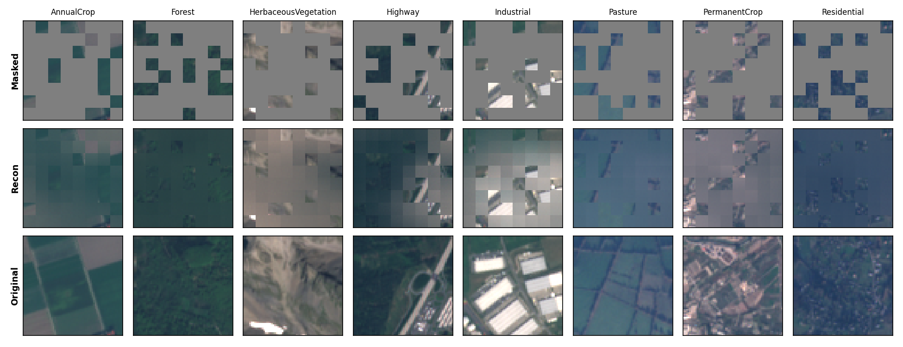
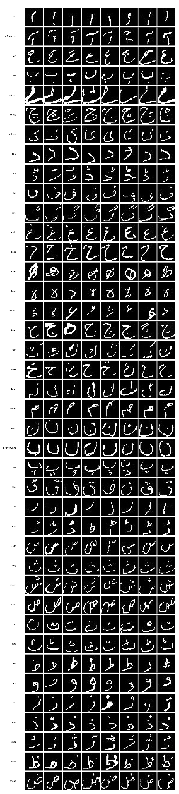
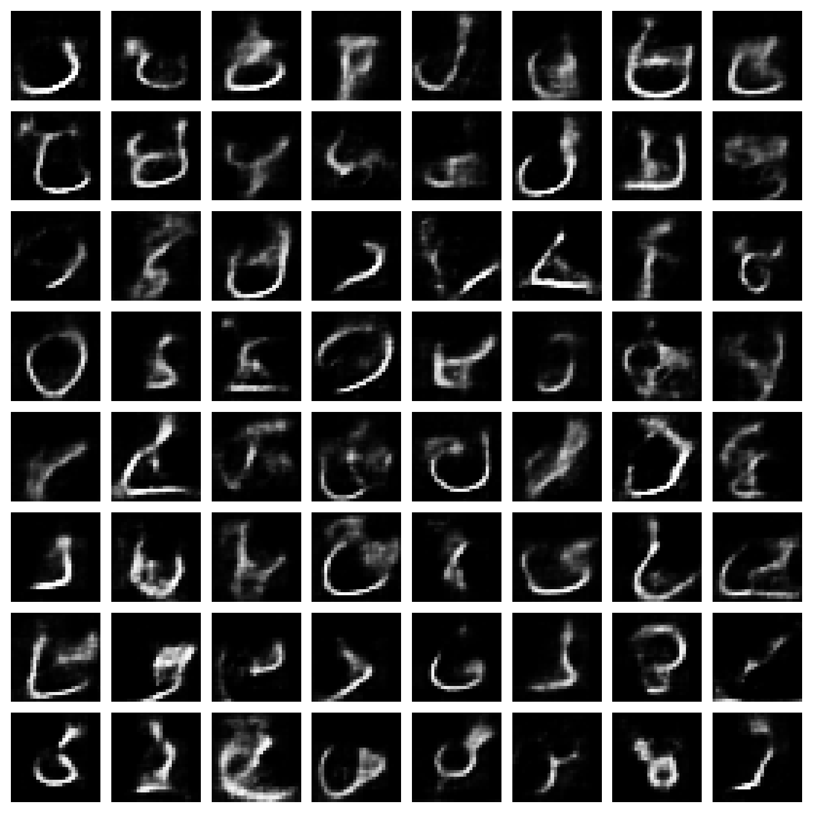
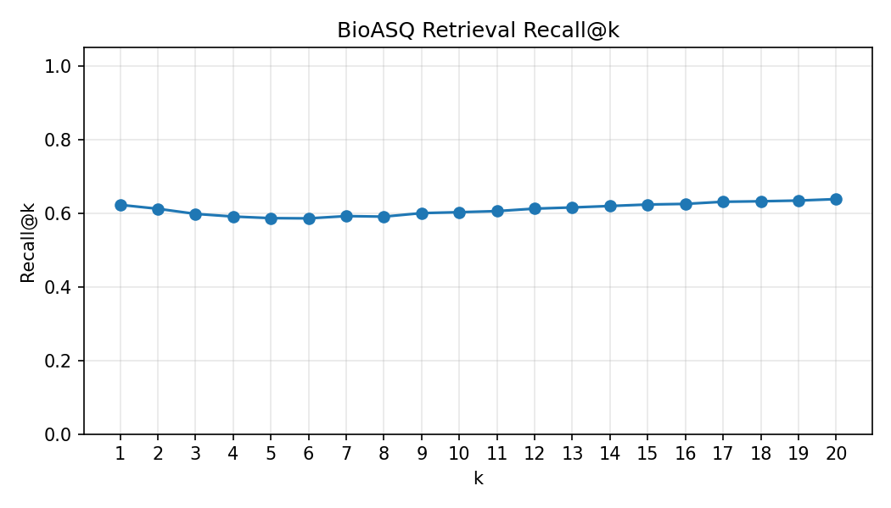

# GenAI-Model-Implementations

From-scratch PyTorch implementations of four generative AI architectures—**Masked Autoencoder (MAE)**, **Convolutional Variational Autoencoder (VAE)**, **Class-Conditional Diffusion (DDPM)**, and **Biomedical Retrieval-Augmented Generation (RAG)**—unified in a single interactive Streamlit application.

All core mechanisms (random patch masking, masked-only MSE, reparameterisation, closed-form KL, DDPM linear noise schedule and Algorithms 1 & 2, attention-mask mean pooling, and dot-product retrieval) are implemented directly in PyTorch and NumPy.

---

## Architecture & Models

| Module | Architecture | Dataset | Key Capability |
|---|---|---|---|
| **Part A (`part_a_mae/`)** | Asymmetric ViT MAE (6-layer enc, 2-layer dec) | EuroSAT RGB (`64×64`, 10 classes) | 75% patch masking pretraining + 160-label linear probe |
| **Part B (`part_b_vae/`)** | Convolutional VAE (`d=16`, Bernoulli decoder) | UHaT (`28×28`, 40 Urdu chars) | Prior sampling & latent-space character interpolation |
| **Part C (`part_c_diffusion/`)** | Class-Conditional DDPM (`T=1000`, `UNet2DModel`) | UHaT (`28×28`, 40 Urdu chars) | Generates requested Urdu characters from pure noise |
| **Part D (`part_d_rag/`)** | `all-MiniLM-L6-v2` + `Qwen2.5-1.5B-Instruct` | BioASQ (40,181 PubMed abstracts) | Dense chunk retrieval & cited biomedical Q&A |

---

## Pretrained Weights (Hugging Face Hub)

All trained checkpoints and dense indices are hosted on Hugging Face Hub:
- **Model Hub:** https://huggingface.co/subhan1501/multimodal-generative-suite

When you launch the Streamlit app, `app/app.py` automatically downloads any missing weights into `checkpoints/` via `huggingface_hub`.

---

## Quick Start

```bash
# 1. Clone and install dependencies
git clone https://github.com/Subhans1501/multimodal-generative-suite.git
cd multimodal-generative-suite
pip install -r requirements.txt

# 2. Launch the 4-tab Streamlit web app (auto-downloads weights from Hugging Face)
streamlit run app/app.py
```

### Training from Scratch

```bash
# Verify dataset loaders (place UHaT under starter/data/uhat/ for Parts B & C)
cd starter && python check_starter.py && cd ..

# Part A: MAE pretraining (100 epochs) & few-label linear classifier (200 epochs)
python part_a_mae/train_mae.py
python part_a_mae/train_classifier.py

# Part B: Convolutional VAE (30 epochs)
python part_b_vae/train_vae.py

# Part C: Class-Conditional DDPM (40 epochs) & sampling
python part_c_diffusion/train_ddpm.py
python part_c_diffusion/sample_ddpm.py

# Part D: BioASQ chunking/indexing, retrieval eval & Qwen2.5-1.5B generation
python part_d_rag/chunk_and_index.py
python part_d_rag/retriever.py
python part_d_rag/generate_and_eval.py
```

---

## Benchmark Results (Tesla T4 GPU)

### Training Summary

| Model | Parameters | Final Training Loss | Training Time |
|---|---:|---:|---:|
| MAE (Encoder + Decoder) | 3,173,504 | 0.006059 (Masked MSE) | 8.0 min |
| Convolutional VAE | 220,385 | 130.90 nats | 0.6 min |
| DDPM U-Net | 4,028,353 | 0.022605 (`L_simple` MSE) | 34.7 min |

### Downstream & Generative Metrics

| Task | Metric | Score |
|---|---|---|
| **MAE Few-Label Probe** | Test accuracy on 5,400 EuroSAT tiles (160 labelled train) | **53.72%** (chance: 10.0%) |
| **VAE Test ELBO** | Negative ELBO (`Reconstruction + KL`) | **131.15** = `106.43 + 24.71` nats |
| **BioASQ Retrieval** | `Hit@1` / `Hit@5` / `Hit@10` | **0.6223** / **0.8161** / **0.8614** |
| **BioASQ Retrieval** | `Recall@1` / `Recall@5` / `Recall@10` / `MRR@10` | **0.6223** / **0.5863** / **0.6024** / **0.7061** |
| **BioASQ Generation (100 Qs)** | `ROUGE-L` / `Citation Precision` / `Abstention Rate` | **0.2169** / **72.31% (47/65)** / **15.0%** |

---

## Visual Highlights

| MAE Reconstructions (75% Masked) | DDPM 40-Class Urdu Samples |
|---|---|
|  |  |

| VAE Prior Samples | BioASQ Recall@k Curve |
|---|---|
|  |  |

> **Medical Disclaimer (Part D):** *For educational use only. Not medical advice.*
